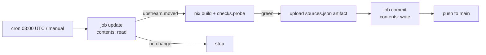

# Spec: Package OmaBroadcast as a Nix flake with nightly upstream updates

Answers to the intent's open questions (owner accepted the recommendations):
track upstream `main`; nightly lands directly on `main` from a job that never
runs upstream code; p620 gets a flake input, p620 only; build everything
upstream builds, accept on recording, preview and screen share. FFmpeg is
decided below.

## Design

Upstream facts this rests on (read from commit `827031a`):

- `bin/build-ffmpeg` pins FFmpeg `47b92841e33b67c1699394415641b34d1157d8d7`
  (release/9.1) and says why it carries its own: the **Vulkan APV encoder,
  new in 9.1**, and the NVIDIA-sleep patch. nixpkgs FFmpeg 9.0.2 lacks the
  encoder, so it is out.
- The app links FFmpeg through pkg-config (`PKGCONFIG += libavcodec …` in
  `omabroadcast.pro`). `CONFIG+=carried_ffmpeg` only adds rpaths to
  `/usr/lib/omabroadcast/...`, which we do not want.
- The browser helper (`browser/omabroadcast-browser.pro`, Qt WebEngine) is a
  separate process; the app finds it via `OMABROADCAST_BROWSER_HELPER`,
  then `applicationDirPath()`, then `/usr/lib/omabroadcast/`
  (`src/capture/browser_page.cpp:29-35`). nixpkgs `qtwebengine` links its own
  FFmpeg 9.0.2; it lives in the helper process only, so no clash.
- Runtime tools the app calls: `hyprctl` (8 sites), `slurp`, `omarchy`.
- `omabroadcast --probe` with no display runs offscreen, prints and exits
  (`src/main.cpp:176-183`): our smoke test.
- MODNet weights (13 MB) are in the repo; no other build-time downloads apart
  from the FFmpeg git fetch, which we replace.

### Files in this repo

| File | Content |
| ---- | ------- |
| `flake.nix` | inputs: `nixpkgs` (nixos-unstable). Outputs for `x86_64-linux`: `packages.{omabroadcast,ffmpeg-omabroadcast,default}`, `nixosModules.default`, `checks.probe`, `formatter`. |
| `sources.json` | the pins the nightly job rewrites: `{ version, rev, hash, ffmpeg: { rev, hash } }`. |
| `nix/ffmpeg.nix` | our own FFmpeg derivation: `fetchFromGitHub FFmpeg/FFmpeg` at `ffmpeg.rev`, the patches from upstream's `pkgbuild/ffmpeg/*.patch` (read from the app's `src`, sorted), and **exactly upstream's configure flags** (copied from `bin/build-ffmpeg`, minus `--prefix`). Deps from nixpkgs: x264, x265, svt-av1, libaom, dav1d, libvpx, srt, libopus, snappy, gnutls, bzip2, xz, zlib, libdrm, libva, vulkan-headers/loader, nv-codec-headers (newest in nixpkgs), nasm, clang (`--enable-cuda-llvm`). |
| `nix/package.nix` | `stdenv.mkDerivation` with `qt6.wrapQtAppsHook`, `qmake`, `pkg-config`, `glslang`, `wayland-scanner`. `src` from `sources.json`. `postPatch`: patch `/usr/lib/omabroadcast/omabroadcast-browser` → `$out/libexec/omabroadcast/omabroadcast-browser`; `pkgver`/`pkgrel` read from PKGBUILD stays (version shows as `0.1.0-62`). Build: run `bin/shaders`, then qmake app with `CONFIG+=packaged`, then qmake the browser; no `bin/build` (it calls `build-ffmpeg`, which fetches). Install the binary, helper, desktop file, icon, licences. Wrapper: `--prefix PATH : slurp` (hyprctl and omarchy come from the host on purpose: they must match the running compositor). `meta.license` = `[ mit gpl3Plus asl20 isc ]`, `platforms = [ "x86_64-linux" ]`, `mainProgram`. |
| `nix/module.nix` | `programs.omabroadcast.enable` + `.package`; adds it to `environment.systemPackages` and sets `xdg.portal.enable` and `services.pipewire.enable` with `mkDefault` (already true on Nixarchy; harmless elsewhere). No other options. |
| `update.sh` | reads upstream `main` HEAD (`git ls-remote`); if it differs from `sources.json.rev`, prefetches it (`nix flake prefetch github:28allday/omabroadcast/<rev> --json`), reads FFmpeg's `COMMIT=` and `pkgver` from that tree, prefetches FFmpeg if changed, rewrites `sources.json` with `jq`. Exits 0 with no change when upstream did not move. |
| `.github/workflows/update.yml` | see below |
| `.github/workflows/ci.yml` | on push/PR: `nix flake check` (builds `checks.probe`). |
| `README.md` | install via flake input + module, `nix run`, update policy. |

### Nightly workflow (`update.yml`)

- Job `update` (permissions `contents: read`): checkout, install Nix
  (`DeterminateSystems/nix-installer-action`), `./update.sh`, then
  `nix build .#omabroadcast` and `nix flake check`. On success uploads
  `sources.json` as an artifact and sets output `changed=true`.
- Job `commit` (needs `update`, `if: changed`, permissions `contents: write`):
  checkout, download the artifact, check it is valid JSON with only the
  expected keys, commit `chore: update omabroadcast to <short rev>` and push.
  It runs no Nix and no upstream code.
- `concurrency: update`, so a manual run cannot race the cron run.
- Free-runner fit: Qt 6/WebEngine come from cache.nixos.org; only FFmpeg
  (~15 min) and the app (~10 min) build, and only on nights upstream moved.
  No binary cache of our own (shortcut: add `nix-community/cache-nix-action`
  if build time becomes a problem). The runner has ~14 GB free disk, which is
  enough for this closure.

### p620

New file `~/.config/nixos/hosts/p620/nixos/omabroadcast.nix` imports
`inputs.nixarchy-omabroadcast.nixosModules.default` and sets
`programs.omabroadcast.enable = true`. Flake input
`nixarchy-omabroadcast = { url = "github:olafkfreund/nixarchy-omabroadcast"; inputs.nixpkgs.follows = "nixpkgs"; }`.
This follows the `nixarchy-pixelbuds` pattern already in that flake. Committed
on a branch in `~/.config/nixos`, then `nixos-rebuild switch` on p620.

## Alternatives rejected

- **nixpkgs FFmpeg 9.0.2 + patches**: lacks the Vulkan APV encoder upstream
  carries 9.1 for.
- **`ffmpeg.overrideAttrs` with 9.1 src**: nixpkgs' generic FFmpeg has
  version-gated patches and ~150 flags; overriding fights it, and the result
  differs from what upstream tests. Our 40-line derivation with upstream's
  exact flags is smaller and faithful.
- **Running upstream `bin/build` in the derivation**: it `git fetch`es FFmpeg
  and calls `pacman`; not possible in the sandbox.
- **Bundling the helper in `$out/bin`**: puts `omabroadcast-browser` on PATH
  for no reason; `libexec` + the patched path is cleaner.
- **Update via PR per night**: owner chose direct commit.
- **Renovate / `nix flake update` on an upstream input**: keeping upstream as
  a flake input (`flake = false`) would make the bump `nix flake lock
  --update-input` instead of `sources.json`, but the FFmpeg pin lives inside
  upstream's shell script and still needs a script to follow it. One file,
  one script is simpler.
- **Home Manager module**: not asked for; the NixOS module is one option.

## Risks

- **Upstream changes its build** (new `PKGCONFIG`, new shaders step, new
  download): the nightly build fails, nothing lands, the job shows red. The
  last good pin stays on `main`. Fix by hand.
- **nv-codec-headers too old for FFmpeg 9.1**: configure fails. Mitigation:
  override `nv-codec-headers` src to the version FFmpeg 9.1 asks for.
- **Patch 0001 does not apply** (it is Arch's patch for 7.x/8.x): drop it in
  our derivation with a comment; the app does not link WebEngine.
- **hyprctl from the host must exist**: true on p620 (Hyprland); on other
  compositors those features fail the same way they do on Arch.
- **p620 switch**: rebuilds the running desktop; rollback is the previous
  generation (`nixos-rebuild switch --rollback`). No other host changes.
- **Licence**: the GPL-3 FFmpeg build is in `$out`; the licences directory
  ships FFmpeg's `COPYING.GPLv3` and the app's `THIRD_PARTY.md`, and the
  source is the public flake plus its pinned sources.

## Verification

1. `nix build .#omabroadcast` succeeds in the sandbox.
2. `nix flake check` passes; `checks.probe` runs `omabroadcast --probe`
   offscreen and exits 0.
3. `ldd result/bin/.omabroadcast-wrapped | grep libavcodec` points at
   `ffmpeg-omabroadcast-9.1`, and FFmpeg's configure log
   (`config.h` in the build, or `strings libavcodec.so`) shows the Vulkan APV
   encoder enabled.
4. `nix run .#omabroadcast -- --probe` prints the machine survey on p620.
5. Workflow: a manual `workflow_dispatch` run with `sources.json` set back one
   commit (or at the current pin, giving a no-op) completes green and, for the
   changed case, pushes one commit.
6. p620 after the switch: the app is in the launcher; by hand: preview shows
   a screen source via the portal picker, a 10 s recording to a file plays
   back, and a browser source loads a page.
