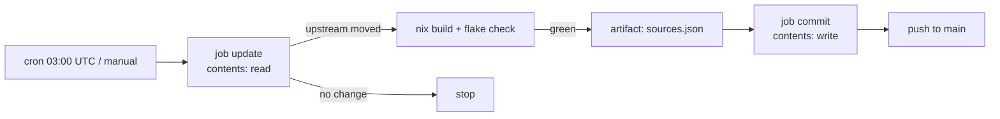

# Spec: Package OmaBroadcast as a Nix flake with nightly upstream updates

Answers to the intent's open questions (owner accepted the recommendations):
track upstream `main`; nightly lands directly on `main` from a job that never
runs upstream code; p620 gets a flake input, p620 only; build everything
upstream builds, accept on recording, preview and screen share. FFmpeg is
decided below.

## Design

Upstream facts this rests on (read from commit `827031a`):

- `bin/build-ffmpeg:4-6` pins FFmpeg `47b92841…` (release/9.1) for the
  **Vulkan APV encoder, new in 9.1**, and the NVIDIA-sleep patch. nixpkgs
  FFmpeg 9.0.2 lacks the encoder, so it is out. FFmpeg's `configure:3100`:
  `apv_vulkan_encoder_select="vulkan spirv_compiler …"`, so FFmpeg's build
  needs glslang. `configure:7109` needs `ffnvcodec >= 12.1.14.0`, which
  nixpkgs `nv-codec-headers-12` (12.1.14.0) meets.
- The app links FFmpeg via pkg-config (`omabroadcast.pro:4`).
  `CONFIG+=carried_ffmpeg` only adds `/usr/lib/omabroadcast` rpaths; we leave
  it off.
- **Qt WebEngine runs in two places**: the browser-source helper
  (`browser/`, a separate process, found via `OMABROADCAST_BROWSER_HELPER`,
  `src/capture/browser_page.cpp:29-35`) and **custom browser docks, which load
  WebEngine QML into the app's own process** (`src/main.cpp:172-174`, found
  via QML import paths, `src/backendbrowser.cpp:14-24`). nixpkgs qtwebengine
  is linked against nixpkgs FFmpeg 9.0.2; in the app process the app's FFmpeg
  9.1 (same sonames) is loaded first and serves WebEngine too. That is why
  upstream's patch `0001-Add-av_stream_get_first_dts-for-Chromium.patch`
  exists. **Both upstream patches are mandatory**; if one stops applying,
  the build fails.
- Runtime tools: `hyprctl` (8 sites), `slurp`, `omarchy`. Secrets go over
  D-Bus `org.freedesktop.secrets` (`src/control/secrets.cpp:14`), no libsecret.
- `omabroadcast --probe` with no display runs offscreen, prints and exits 0
  (`src/main.cpp:176-183`). It returns before the UI and exits 0 without a GPU,
  so it proves "starts and links", not "works".
- MODNet weights are in the repo. The only build-time download is
  `build-ffmpeg`'s `git fetch`, which we replace. `bin/shaders` writes
  `src/engine/shaders/gen/` in the (writable) unpacked source;
  `omabroadcast.pro:24-27` reads PKGBUILD with `sed` and writes under
  `OUT_PWD`; `wayland.pri` runs `wayland-scanner` from PATH. All fine in the
  sandbox.

### Files in this repo

| File | Content |
| ---- | ------- |
| `flake.nix` | input `nixpkgs` (nixos-unstable). Outputs for `x86_64-linux`: `packages.{omabroadcast,ffmpeg-omabroadcast,default}`, `nixosModules.default`, `checks.{probe,build}`, `formatter`. |
| `sources.json` | the pins the nightly job rewrites: `{ version, rev, hash, ffmpeg: { rev, hash } }`. |
| `nix/ffmpeg.nix` | `stdenv.mkDerivation`: `fetchFromGitHub FFmpeg/FFmpeg` at `ffmpeg.rev`; `patches` = upstream's `pkgbuild/ffmpeg/*.patch` from the app `src`, sorted. **Flags are read from upstream at build time, not copied**: `configurePhase` extracts the `FLAGS="…"` block from `${appSrc}/bin/build-ffmpeg` with `sed` (never sourced or executed), drops `--prefix=…`, adds `--prefix=$out`. An upstream flag change then either just works or fails configure loudly; it never silently builds stale flags. nativeBuildInputs: nasm, pkg-config, clang (`--enable-cuda-llvm`), glslang. buildInputs: x264, x265, svt-av1, libaom, dav1d, libvpx, srt, libopus, snappy, gnutls, bzip2, xz, zlib, libdrm, libva, vulkan-headers, vulkan-loader, nv-codec-headers-12. `meta.license = gpl3Plus`. |
| `nix/package.nix` | `stdenv.mkDerivation`, `src` from `sources.json`. nativeBuildInputs: `qt6.qmake`, `qt6.wrapQtAppsHook`, `qt6.qttools`, pkg-config, glslang, wayland-scanner. **buildInputs** (from `omabroadcast.pro:1-4`, `wayland.pri:1`, PKGBUILD depends): qtbase, qtdeclarative, qtwebengine, qtwayland, qtsvg, qtimageformats, qtpositioning, qtwebchannel, rnnoise, vulkan-headers, vulkan-loader, pipewire, wayland, mesa (gbm), libdrm, ffmpeg-omabroadcast. Build: `sh bin/shaders`, `qmake CONFIG+=packaged` + `make` for the app, then the same for `browser/`. No `bin/build`. Install: `$out/bin/omabroadcast`, `$out/libexec/omabroadcast/omabroadcast-browser`, desktop file, icon, licences (app `LICENSE`, `THIRD_PARTY.md`, Lucide, MODNet, FFmpeg's `COPYING.GPLv3`). `installCheckPhase` fails if the helper is missing (the browser `.pro` silently builds nothing without WebEngine). Wrapper (`qtWrapperArgs`, applies to bin and libexec): `--set OMABROADCAST_BROWSER_HELPER $out/libexec/omabroadcast/omabroadcast-browser` (no C++ patch), `--prefix PATH : ${slurp}/bin`. `hyprctl`/`omarchy` come from the host on purpose. `meta.license = [ mit gpl3Plus asl20 isc ]`, `platforms = [ "x86_64-linux" ]`, `mainProgram = "omabroadcast"`. |
| `nix/module.nix` | `programs.omabroadcast.{enable,package}`; adds the package to `environment.systemPackages`; `xdg.portal.enable` and `services.pipewire.{enable,pulse.enable}` with `mkDefault`. The portal backend, Secret Service and GPU drivers stay host-managed, listed as prerequisites in the README. |
| `update.sh` | `git ls-remote` upstream `main`; no change → exit 0. Else `nix flake prefetch github:28allday/omabroadcast/<rev> --json` for the hash, then **static parse** (`sed`/`grep`, never source) of `COMMIT=` from `bin/build-ffmpeg` and `pkgver=`/`pkgrel=` from `pkgbuild/PKGBUILD` in the prefetched store path; validate each against a regex (40-hex rev, semver, integer); prefetch FFmpeg if its rev changed; write `sources.json` with `jq`. |
| `.github/workflows/update.yml` | see below |
| `.github/workflows/ci.yml` | push/PR: `nix flake check`. |
| `README.md` | install, prerequisites, update policy. |

`checks.probe` (runs in the Nix sandbox): `QT_QPA_PLATFORM=offscreen omabroadcast --probe`
exits 0; `ldd` of the wrapped binary resolves `libavcodec` to
`ffmpeg-omabroadcast`; `grep -a apv_vulkan` on that `libavcodec.so` matches;
`omabroadcast-browser --check` exits 0.

### Nightly workflow (`update.yml`)

- Job `update` (`permissions: contents: read`): checkout, install Nix
  (`DeterminateSystems/nix-installer-action`), `./update.sh`, then
  `nix flake check -L` (builds everything). Upstream code only runs inside
  Nix builds. On success uploads only `sources.json` as artifact
  `sources-${{ github.run_id }}`; sets `changed=true`.
- Job `commit` (needs `update`, `if: changed`, `permissions: contents: write`):
  checkout, download that run's named artifact into `$RUNNER_TEMP`, validate
  with `jq` (exact keys, types, regexes as above), copy over `sources.json`,
  `git add sources.json` only, commit `chore: update omabroadcast to <rev>`
  (rev passed via env var, not interpolated), push. No Nix, no upstream code.
- `concurrency: update`. Action versions pinned to commit SHAs.
- Runner fit is not assumed: verification step 5 measures a cold run (time,
  peak disk via `df`) and records it in the PR. Shortcut: no binary cache of
  our own; add `nix-community/cache-nix-action` if the run nears limits.

### p620

New `~/.config/nixos/hosts/p620/nixos/omabroadcast.nix` imports
`inputs.nixarchy-omabroadcast.nixosModules.default` and sets
`programs.omabroadcast.enable = true`; flake input
`nixarchy-omabroadcast = { url = "github:olafkfreund/nixarchy-omabroadcast"; inputs.nixpkgs.follows = "nixpkgs"; };`
(the `nixarchy-pixelbuds` pattern). p620 already runs pipewire-pulse,
wireplumber, xdg-desktop-portal-hyprland and a Secret Service (checked
2026-11-18). Committed on a branch in `~/.config/nixos`, then
`nixos-rebuild switch` on p620.

## Alternatives rejected

- **nixpkgs FFmpeg 9.0.2 + patches**: no Vulkan APV encoder.
- **`ffmpeg.overrideAttrs` with 9.1 src**: nixpkgs' generic FFmpeg has
  version-gated patches and ~150 flags of its own; the result would not be
  what upstream tests.
- **Copying upstream's flags into Nix**: drifts silently; reading them at
  build time cannot.
- **Running upstream `bin/build`**: it `git fetch`es and calls `pacman`.
- **Patching the helper path in C++**: the app already reads
  `OMABROADCAST_BROWSER_HELPER`.
- **Update PR per night**: owner chose direct commit.
- **Upstream as a `flake = false` input**: the FFmpeg pin inside upstream's
  shell script still needs a script; one JSON file + one script is simpler.
- **Home Manager module**: not asked for.

## Risks

- **Upstream build changes** (new pkg-config dep, new step): nightly build
  fails, nothing lands, job is red; last good pin stays. Fixed by hand.
- **FFmpeg 9.1 and nixpkgs WebEngine in one process**: WebEngine was built
  against 9.0.2 headers and runs on our 9.1. Upstream does the same on Arch
  (WebEngine built against Arch's FFmpeg), so the ABI risk is the one upstream
  already takes. Tested by hand with a custom browser dock.
- **Same-soname shadowing elsewhere**: any Qt multimedia plugin loaded in the
  app also gets our FFmpeg. Same as upstream.
- **hyprctl must be on the host**: true on p620.
- **p620 switch** rebuilds the running desktop; rollback is
  `nixos-rebuild switch --rollback`. No other host changes.
- **Licence**: the GPL-3 FFmpeg ships in the closure; licences installed as
  above; the corresponding source is the public flake + its pins.

## Verification

1. `nix build .#omabroadcast` in the sandbox.
2. `nix flake check` passes (`checks.probe` as above).
3. `nix run .#omabroadcast -- --probe` on p620 lists the GPU and encoders.
4. CI: `ci.yml` green on the PR.
5. `update.yml` via `workflow_dispatch` twice: once at the current pin
   (no-op, green), once after committing a stale `rev` to `sources.json`
   (upstream has a single commit, so it can't go back one): it re-pins,
   builds and pushes one commit. Cold-run time and peak disk recorded.
6. p620 after the switch, by hand: launcher entry; screen source via the
   portal picker in preview; 10 s recording plays back; a browser source
   loads a page; a custom browser dock opens.
